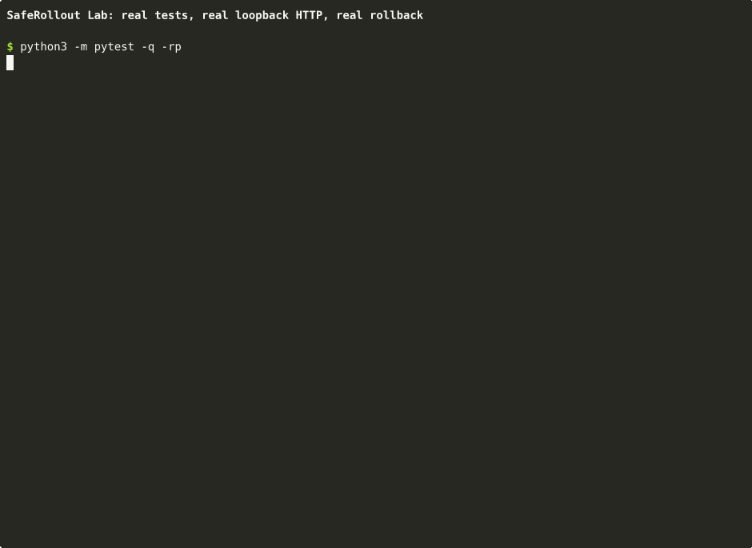

# SafeRollout Lab

[](https://github.com/PontoPe/SafeRolloutLab/actions/workflows/ci.yml)

**Can a functionally correct but computationally expensive security rule be rejected before promotion, and rolled back without depending on the HTTP service it affects?**

SafeRollout Lab is a small, local Python lab that answers that question with real processes, real loopback HTTP traffic and recorded evidence. It is a portfolio/learning project for a single trusted operator on one Linux host. It is **not** a WAF, a production deployment platform, or a reproduction of Cloudflare's scale.

## Inspiration

The lab is modelled on a failure pattern described in John Graham-Cumming's Cloudflare post-mortem, [Details of the Cloudflare outage on July 2, 2019](https://blog.cloudflare.com/details-of-the-cloudflare-outage-on-july-2-2019/): a WAF rule with a catastrophically backtracking regular expression was deployed globally and exhausted CPU. The concerns taken from it are (1) rules need CPU-cost testing, not only functional tests, (2) rollout should be staged rather than global, and (3) recovery should not depend on the environment that is failing. This lab explores those three concerns at toy scale. It uses no Cloudflare code, API or data.

## Demo



One unedited run of [`scripts/demo-recording.sh`](scripts/demo-recording.sh) (31.6 s asciicast; the GIF is rendered from it with pauses capped at 3 s): the 23 tests by name, the full loopback HTTP experiment (1,510 server observations), a source-hash check of the run summary, and the rollback outcomes. The cast file, exact recording command and the run's `summary.json` are in [docs/demo/README.md](docs/demo/README.md). GitHub does not play `.cast` files inline; download it and use `asciinema play`.

## What it does

A candidate rule goes through a fixed pipeline. Each step either produces evidence or stops the rollout:

1. **Schema/syntax validation** (the regex is compiled in a child process).
2. **Functional gate**: synthetic positive and legitimate-negative fixtures (`src/saferollout/rules.py`).
3. **Performance gate**: a bounded adversarial input (`'a' * 30 + '!'`) evaluated in a killable, resource-limited child process.
4. **Canary at 10% → 50% → 100%** of deterministically hashed request IDs, with telemetry tagged by exact rule hash and epoch.
5. **Promotion** only when every stage passes. Otherwise **rollback** to the original stable rule, confirmed by reading the route back.

Rules shipped with the lab (`src/saferollout/rules.py`):

| Rule | Pattern | Observed outcome |
|---|---|---|
| `good` | `\Aaa*\Z` | Passes all gates; promoted at 10/50/100% |
| `expensive` | `\A(a+)+\Z` | Passes the functional fixtures; rejected by the default performance gate. With the deliberately weak `small` profile it reaches the canary, times out on a real request and is rolled back |
| `false-positive` | `a` | Blocks the legitimate input `account`; rejected by the functional gate |

Missing, malformed, duplicate or insufficient telemetry yields `INCONCLUSIVE` and never promotes. An expected HTTP 403 (intentional block) is not counted as an availability error. Each decision is run by a fresh controller process; replaying a terminal state returns `NOOP`, so a restarted controller does not promote twice.

## Architecture and scope

```text
separate finite loadgen process --HTTP/127.0.0.1--> API/router process
                                                    |
                                         deterministic SHA-256 bucket
                                           /                    \
                                stable lane                  candidate lane
                              worker supervisor             worker supervisor
                             1 active + 1 queued           1 active + 1 queued
                                    |                            |
                           short-lived regex child      short-lived regex child
                                    \                            /
                                       versioned metrics.jsonl

separate controller CLI process --> telemetry + route.json + decision journal
                                      |
                         lock/CAS -> fsync/atomic rename -> exact readback
```

- **Single trusted operator.** The operator, interpreter, source tree and same-user filesystem are trusted. Controller commands must be serialized: the halt check and the route compare-and-swap are not one transaction across overlapping controllers. See the [threat model](docs/threat-model.md).
- **Stable vs. candidate independence.** The stable (production-like) rule and the candidate (staging/canary-like) rule run in separate worker lanes, each with its own capacity limit and bounded queue, so a slow candidate cannot take stable capacity (`tests/test_lane_isolation.py`). Both lanes are served by **one** HTTP frontend on **one** host and share its filesystem. This is lane isolation, not two independently deployed environments.
- **Control plane independent of the data plane.** Rollout state lives in a dedicated local route file (`src/saferollout/router.py`) driven by a separate controller CLI (`src/saferollout/controller.py`). Rollback needs no HTTP server (`tests/test_controller.py::test_controller_rollback_independent_and_failure_is_honest` runs without one), and the demo terminates the API process before rolling back (`api_down_rollback` in `src/saferollout/demo.py`). It does not survive host or disk loss.
- **Honest failure.** If rollback cannot complete (for example, the control lock is held), the result is `ROLLBACK_FAILED`, never a recovery claim. A persisted halt latch then blocks `begin`/`observe` across controller restarts until an explicit, verified rollback. The latch fixes a real rollback→promotion defect, with RED/GREEN regression evidence; see the [case study](docs/case-study.md).
- At the 100% stage a separately labelled `/baseline` control cohort keeps a concurrent stable comparison; it is not counted as routed exposure.

Contracts and resource limits: [docs/architecture.md](docs/architecture.md).

## Run and test

Verified on Linux with CPython 3.11.2, pytest 7.2.1 and gitleaks 8.30.1. The runtime uses only the Python standard library. No credentials or `.env` are needed.

```sh
git clone https://github.com/PontoPe/SafeRolloutLab.git
cd SafeRolloutLab
python3 -m venv .venv
. .venv/bin/activate
python -m pip install '.[test]'      # pytest==7.2.1
python -m pytest -q                  # 23 tests
./scripts/demo.sh .run/my-demo 100   # full loopback HTTP experiment; needs a new directory
```

The following also need gitleaks 8.30.1 on `PATH` (CI downloads it and verifies its SHA-256):

```sh
./scripts/ci.sh                      # tests + compileall + gitleaks directory scan
./scripts/install-hooks.sh           # project-local pre-commit secret scan
./scripts/demo-recording.sh          # the command sequence shown in the demo
```

`scripts/demo.sh` starts a loopback API, a separate bounded load-generator process and a new controller OS process per decision. It covers baseline, 10/50/100% promotion, functional and performance rejection, canary timeout and rollback, missing telemetry, insufficient sample, controller restart/idempotence, API outage, deliberate control-lock failure, recovery and cleanup, and exits nonzero if any checked assertion fails. Its evidence is `summary.json`, raw `metrics.jsonl`, `client-*.jsonl`, `commands.jsonl` and the decision journal. No benchmark data is synthesized.

Manual step-by-step session and failure handling: [docs/runbook.md](docs/runbook.md).

**Calibration.** The controller defaults to 1,000 observations per version per stage. The demo explicitly uses 100, with finite serial load and a 90-second load budget per stage; integration tests use 10 as a smoke check, not performance evidence. p95 is nearest-rank (only five tail observations at n=100); no p99 or confidence claim is made.

## CI

[`.github/workflows/ci.yml`](.github/workflows/ci.yml) runs on pushes and pull requests to `main`:

- `tests`: installs `.[test]`, runs `pytest -q` (including the bounded HTTP smoke experiment) and `compileall`.
- `gitleaks`: downloads gitleaks 8.30.1, checks its SHA-256, then scans the working tree and the full Git history.

Actions are pinned by commit SHA, the workflow token is limited to `contents: read`, and checkout does not persist credentials. CI does not deploy or publish anything.

## Limits (explicit non-claims)

Aligned with the [delivery report](docs/delivery-report.md) and [publication notes](docs/publication.md):

- **No Docker / Compose.** The original plan proposed Compose; the native Linux fallback was used instead. No image was pulled or built and no container isolation is claimed.
- **No high availability.** One HTTP frontend hosts both worker lanes; stopping it stops both until restart. Controller, data plane and state share one host and filesystem. There are no independent API hosts, no multi-region setup and no distributed control plane.
- **No watchdog.** `observe` runs only when the experiment or operator invokes it. The 120-second stage deadline is checked at observation time; if observation stops, the last route stays in place until observation or rollback resumes.
- **Not production-ready.** Synthetic traffic only, finite serial load, loopback only, no authentication or TLS. Not a WAF, not a benchmark, no SLO evidence.
- **Single operator, serialized commands.** Not safe for concurrent controllers or multiple operators.
- **Halt persistence depends on storage.** Restart safety requires that the halt sidecar was persisted (an unreadable sidecar also fails closed). If storage prevents creating it and rollback also fails, only the current process keeps the halt; the operator must repair storage and restore the route before restarting or advancing.
- **Resource limits fit this regex workload only.** `RLIMIT_CPU`, `RLIMIT_AS`, `RLIMIT_NPROC` and a wall-clock kill bound the regex child; they are not a sandbox for arbitrary code.

## Documentation

- [Case study](docs/case-study.md): problem, design decisions, the rollback→promotion defect and its fix, next steps.
- [Technical case with measurements](docs/technical-case.md) and [raw evidence index](docs/evidence/README.md).
- [Architecture](docs/architecture.md), [threat model](docs/threat-model.md), [runbook](docs/runbook.md).
- [CV bullets with evidence map](docs/cv-bullets.md).
- [Learning mission](docs/learning-mission.md): progressive exercises to understand and defend the project.
- [Demo](docs/demo/README.md), [publication notes](docs/publication.md), [historical delivery report](docs/delivery-report.md).
