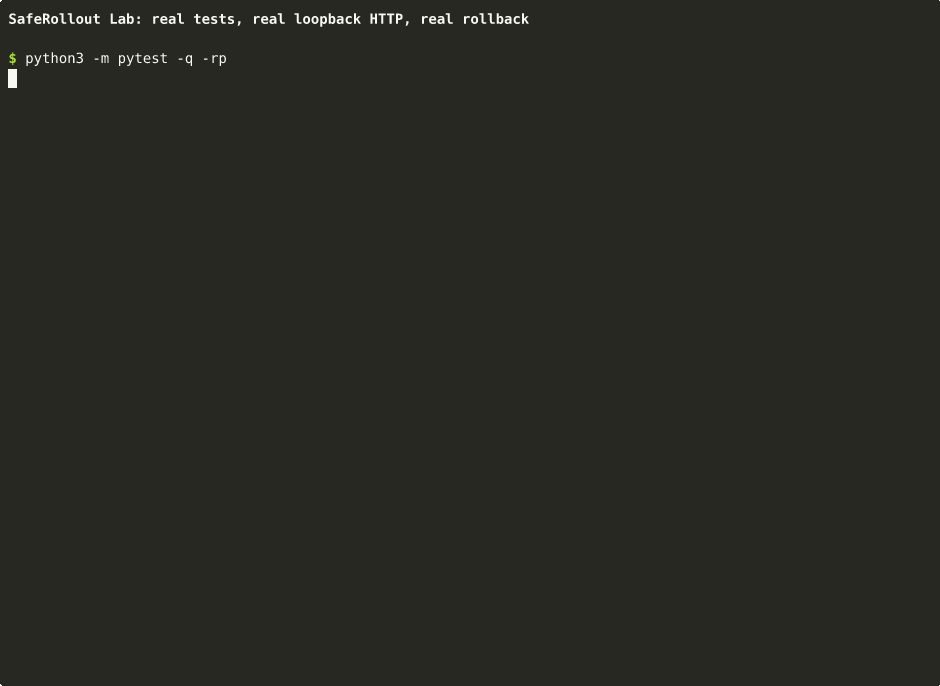

# Recorded demo — real commands, real HTTP

## Short demo (asciinema, 32 s)



[saferollout-demo.cast](saferollout-demo.cast?raw=true) (asciicast v2, 6 KB, 31.6 s) and [saferollout-demo.gif](saferollout-demo.gif) (205 KB, rendered from the same cast) show one unedited run of [`scripts/demo-recording.sh`](../../scripts/demo-recording.sh). It prints each command after `$ ` immediately before running it:

1. `python3 -m pytest -q -rp`: all 23 tests by name, including the rollback halt-latch regressions (`test_failed_final_stage_rollback_halts_across_restart_until_recovery`, `test_audit_failure_still_restores_and_requires_explicit_recovery`, `test_unwritable_halt_latch_still_restores_and_halts_in_process`).
2. `./scripts/demo.sh <run>/evidence 100 > <run>/demo-stdout.json`: the full loopback HTTP experiment. Its one-line stdout contains an absolute path, so it is redirected to a file rather than displayed.
3. `python3 scripts/record-demo.py --report <run>/evidence/summary.json`: measured outcomes and runtime source-hash check.
4. An inline reader (in the script) printing bad canary REJECT → ROLLED_BACK, API-stopped rollback, ROLLBACK_FAILED under lock contention, operator recovery and final route.

The run's [summary.json](saferollout-demo-summary.json) is kept beside the cast (started 2026-11-17T22:34:35Z, 1,510 observations, 1 intentional timeout). Other raw files from that run stayed in the ignored `.run/` directory. The GIF compresses pauses longer than 3 s (agg `--idle-time-limit 3`); the cast keeps real timing.

Exact recording command (asciinema 2.4.0, agg 1.5.0, both installed user-local in `~/.local/bin`), run from the repository root with a minimal environment so no shell variables or `.env` values can appear:

```sh
env -i PATH="$HOME/.local/bin:/usr/local/bin:/usr/bin:/bin" HOME="$HOME" TERM=xterm-256color SHELL=/bin/sh LANG=C.UTF-8 \
  asciinema rec --quiet --cols 110 --rows 34 \
  --title "SafeRollout Lab: real tests, HTTP experiment and rollback" \
  --command "./scripts/demo-recording.sh .run/demo-recording-published" docs/demo/saferollout-demo.cast
agg --idle-time-limit 3 --font-size 14 --theme monokai docs/demo/saferollout-demo.cast docs/demo/saferollout-demo.gif
```

To reproduce without recording: `./scripts/demo-recording.sh` (writes to a fresh ignored `.run/demo-recording-<UTC>/`). Timings and PIDs will differ; decisions are asserted by the experiment.

## Publication recording (stdlib recorder)

Download [demo.cast](publication/demo.cast?raw=true) and replay with an asciicast-v2-compatible player, for example `asciinema play demo.cast` (optional viewer, not a project dependency). GitHub does not play casts inline. The [plain transcript](publication/transcript.txt) is extracted from the same recording. No terminal frames, test results or benchmark values were fabricated.

The recording runs:

1. `python3 -m pytest -q`: 23 tests, including the small real-process integration experiment.
2. `./scripts/demo.sh docs/demo/publication/evidence 100`: full finite loopback HTTP experiment, separate load generator and fresh controller process per decision.
3. `python3 scripts/record-demo.py --report docs/demo/publication/evidence/summary.json`: reads the actual summary and verifies runtime source hashes against this checkout.

Observed: 1,510 server observations, 1 intentional bounded regex timeout, good rule PASS at 10/50/100%, false-positive/default expensive preflight REJECTED, blind-profile canary REJECT followed by verified rollback, missing/insufficient telemetry INCONCLUSIVE, API-stopped rollback ROLLED_BACK, deliberate lock contention ROLLBACK_FAILED, then explicit recovery ROLLED_BACK. Post-rollback HTTP returned 200; both API processes were reaped.

Raw [summary](publication/evidence/summary.json), [commands](publication/evidence/commands.jsonl), [server metrics](publication/evidence/metrics.jsonl) and client JSONL remain separate from the earlier `native-mvp-03` run. Do not merge runs or reuse timing values as production SLOs. The default policy is 1,000 observations/version/stage; this recorded shared-host demonstration explicitly uses 100. Statistical and host/storage limitations remain those in the [case](../technical-case.md) and [historical report](../delivery-report.md).

Record a new run without overwriting this evidence:

```sh
python3 scripts/record-demo.py
```

The stdlib recorder uses a PTY and monotonic timestamps, saves real output as asciicast v2, and propagates command failure. Its default output is a fresh ignored `.run/recording-<UTC>/` directory. The recording predates its publication commit: the summary uses exact runtime source SHA-256 values; none of the nine runtime modules changed during publication.
